# Centralised Manufacturing Quality KPI Reporting System — Project Blueprint

**Document status:** v0.2, decisions D1–D6 agreed (see §14). Phase 1 complete.
**Date:** 2026-11-11

---

## 0. Current state of the project (verified 2026-11-11)

Before designing anything, I checked what already exists, so the plan builds on it instead of replacing it.

### Local environment

| Component | State | Notes |
|---|---|---|
| Git | ✅ 2.56 | Repo `main`, remote `origin` → GitHub `Centralised-Management-Reporting-KPI-Automation-System` |
| GitHub CLI (`gh`) | ❌ not installed: the silent install stalled on an admin (UAC) prompt | Needed for issues and PRs from the terminal. Install with `winget install --id GitHub.cli -e`, approve the prompt, then run `gh auth login` once. |
| Python | ✅ 3.15.2 in `.venv` | pandas, numpy, pyarrow, SQLAlchemy, pyodbc, azure-storage-blob, azure-identity, python-dotenv |
| `openpyxl`, `pytest` | ✅ installed in this step | Excel ingestion and tests. **Not yet in `requirements.txt`** (added in Phase 4). |
| ODBC Driver 18 for SQL Server | ✅ | Required by pyodbc for Azure SQL |
| `sqlcmd` | ✅ (ODBC 180 tools) | Command-line SQL execution |
| SQL Server 2025 Express (`.\SQLEXPRESS`) | ✅ running | Will be used as the **local development database** |
| SSMS 22 | ✅ | |
| Power BI Desktop (Store version) | ✅ | |
| Azure CLI | ✅ logged in, *Azure for Students* | |
| VS Code, Node, .NET | ✅ | Node/.NET not required by this project |

### Azure

| Resource | State |
|---|---|
| Resource group `Centralised-KPI-Reporting-System` | ✅ exists |
| Storage account `azurestoragecentralkpi` (Switzerland North) | ✅ exists. Containers: `rawdata`, `stagingdata`, `processeddata`, `archive`, `backupdata`. Connection test passed. |
| Azure SQL Server / Database | ❌ **does not exist yet**, although `.env` already contains `AZURE_SQL_SERVER` / `AZURE_SQL_DATABASE` values (placeholders or a deleted server) |
| Region policy | Subscription only allows: `switzerlandnorth`, `denmarkeast`, `austriaeast`, `polandcentral`, `belgiumcentral` |

### Repository content

| File | Assessment |
|---|---|
| `01_create_tables.sql` (repo root) | First draft schema. Reviewed in §5.1. Will be superseded and moved to `sql/` in Phase 4. |
| `python/extraction/test_blob_connection.py` | Works. Keep as a connectivity smoke test. |
| `powerbi/Centralised-KPI-Report-System.pbip` + `.Report` + `.SemanticModel` | Empty PBIP shell: no tables, one blank page. **Moved from the repo root and the "Centarlised" spelling corrected on 2026-11-11** (decision D4). References in `.pbip`, `definition.pbir` and both `.platform` files were updated; the model was verified to load from the new path. |
| `.env.example` | **Empty.** Must list every variable name, with no values. |
| `.env` | Correctly git-ignored. No `AZURE_SQL_PASSWORD`, which is consistent with the recommended Entra ID authentication (§8). |
| `requirements.txt` | Full `pip freeze`. Fine, but missing `openpyxl` and `pytest`. |
| `README.md` | One line. To be written in Phase 11. |

---

## 1. Business concept and project vision

### 1.1 Scenario

**Fictional company:** *Danube Automotive Components d.o.o.* is a Tier‑1 supplier producing interior and body components for three OEM vehicle programs.

| Dimension | Simulated values |
|---|---|
| Plant | 1 plant (scope can extend to more) |
| Production lines | 6 lines (e.g. L01 Injection Moulding, L02 Injection Moulding, L03 Paint Shop, L04 Assembly – Door Panels, L05 Assembly – Dashboards, L06 Welding – Brackets) |
| Shifts | 3 × 8 h (Early 06–14, Late 14–22, Night 22–06) |
| Vehicle programs | 3 (e.g. `VP-SUV-C`, `VP-HATCH-B`, `VP-EV-D`), each with SOP and EOP dates |
| Part numbers | ~40 parts, each with a standard cost and defect opportunities per unit |
| Defect catalogue | ~25 defect types in 5 categories (Dimensional, Surface/Cosmetic, Assembly, Material, Functional) with severity (A/B/C) |
| History | 24 months of daily data, enough for trends, seasonality and repeat-defect analysis |

### 1.2 The problem today

Five departments each keep their own Excel or CSV file:

| Department | Today's file | Typical issues (these will be deliberately injected into the synthetic data) |
|---|---|---|
| Production | Daily output per line/shift (Excel, one sheet per month) | Mixed date formats; line names written differently ("Line 1", "L01", "LINE-01") |
| Quality Assurance | Inspection results and defect log (CSV export from an inspection system) | Duplicate rows from re-exports; defect codes not in the catalogue |
| Rework | Rework log with hours and cost (Excel) | Missing costs; negative quantities from typos |
| Corrective Actions | 8D tracker (Excel) | Free-text status; missing closure dates; no link to production data |
| Quality Management | Monthly KPI workbook and audit findings log | Each month calculated slightly differently; KPI definitions not written down; audit findings tracked separately from 8Ds, with inconsistent classification ("major", "Major NC", "MAJ") |

As a result, three managers can get three different scrap rates for the same month. Reports take days to consolidate, and an overdue 8D only gets noticed at the monthly review.

### 1.3 Vision

> **One governed quality data platform with one definition per KPI and one number per KPI, available every morning without manual consolidation.**

### 1.4 Objectives (measurable)

1. Consolidate all 5 sources into one database with a documented data lineage for every row.
2. Publish a KPI dictionary in which every KPI has exactly one formula, used identically in SQL and DAX.
3. Cut manual report preparation from roughly 2 days a month to 0 (fully automated refresh).
4. Have every rejected source row logged with a reason, so nothing is silently dropped.
5. Show open and overdue 8Ds daily instead of monthly.

### 1.5 Scope

**In scope:** synthetic source data, Python ETL, local and Azure SQL databases, SQL reporting layer, Power BI report (8 pages, including Audit & Compliance), documentation, Notion project management, GitHub repository.

**Out of scope:** real plant integration (MES/ERP), real-time streaming, row-level security for many users (designed for, but not deployed), and the Power BI Service (publishing depends on licence availability; see R6).

---

## 2. System architecture

### 2.1 Layered architecture

```
┌──────────────────────────────────────────────────────────────────────────────┐
│ 1. SOURCE LAYER (simulated departments)                                      │
│   Production.xlsx · QA_Inspections.csv · QA_Defects.csv · Rework.xlsx ·      │
│   Scrap.csv · 8D_Tracker.xlsx · Master data (parts, lines, programs, defects)│
└───────────────┬──────────────────────────────────────────────────────────────┘
                │ python/generate (Phase 5) writes them to data/raw/ (local)
                ▼
┌──────────────────────────────────────────────────────────────────────────────┐
│ 2. LANDING / RAW LAYER — Azure Blob Storage `rawdata` container              │
│   Immutable copies: rawdata/<source>/<yyyy>/<mm>/<file>                      │
│   After a successful load → copied to `archive`                              │
└───────────────┬──────────────────────────────────────────────────────────────┘
                ▼
┌──────────────────────────────────────────────────────────────────────────────┐
│ 3. PROCESSING — Python ETL (runs locally; scheduled by Windows Task Scheduler)│
│   extract → validate (schema, types, rules) → standardise → derive →         │
│   conform to dimensions → load stg → MERGE into dw  · rejects → audit tables │
│   Cleaned files optionally written to `processeddata` as Parquet             │
└───────────────┬──────────────────────────────────────────────────────────────┘
                ▼
┌──────────────────────────────────────────────────────────────────────────────┐
│ 4. CENTRAL DATA LAYER — SQL Server (local Express = DEV, Azure SQL = PROD)   │
│   schema stg   : raw-typed staging tables, truncated per load                │
│   schema dw    : star schema (dimensions + facts) = single source of truth   │
│   schema audit : ETL run log, file manifest, rejected rows, DQ results       │
│   schema rpt   : views that apply KPI definitions, used by Power BI          │
└───────────────┬──────────────────────────────────────────────────────────────┘
                ▼
┌──────────────────────────────────────────────────────────────────────────────┐
│ 5. SEMANTIC LAYER — Power BI semantic model (PBIP, versioned in Git)         │
│   Import mode from rpt views · star schema · DAX measures = KPI dictionary   │
└───────────────┬──────────────────────────────────────────────────────────────┘
                ▼
┌──────────────────────────────────────────────────────────────────────────────┐
│ 6. PRESENTATION — Power BI report, 8 pages (executive → operational)         │
└──────────────────────────────────────────────────────────────────────────────┘

Cross-cutting: GitHub (code, SQL, PBIP, docs) · Notion (requirements, tasks,
decisions, KPI dictionary) · .env + Entra ID (secrets) · pytest (tests)
```

### 2.2 Data flow diagram

```mermaid
flowchart LR
    subgraph SRC[Department sources]
        P[Production.xlsx]
        QI[QA_Inspections.csv]
        QD[QA_Defects.csv]
        S[Scrap.csv]
        R[Rework.xlsx]
        D8[8D_Tracker.xlsx]
        AF[Audit_Findings.xlsx]
        MD[Master data.xlsx]
    end
    SRC -->|upload| RAW[(Blob: rawdata)]
    RAW --> EXT[Extract]
    EXT --> VAL{Validate}
    VAL -->|invalid rows| REJ[(audit.rejected_rows)]
    VAL -->|valid rows| TRN[Standardise + derive + conform keys]
    TRN --> STG[(stg.*)]
    STG -->|MERGE / upsert| DW[(dw dims + facts)]
    EXT -.->|file hash, row counts| MAN[(audit.file_manifest)]
    TRN -.->|run summary| RUN[(audit.etl_run)]
    DW --> RPT[rpt views - KPI logic]
    RPT --> PBI[Power BI semantic model]
    PBI --> REP[8-page report]
    RAW -->|after successful load| ARC[(Blob: archive)]
    DW -.->|bacpac export| BAK[(Blob: backupdata)]
```



### 2.3 Environments

| Environment | Database | Storage | Purpose |
|---|---|---|---|
| **DEV (local)** | SQL Server Express `.\SQLEXPRESS`, database `QualityKPI_Dev` | `data/raw` folder (local) | Daily development; free; works offline; no risk of Azure costs |
| **PROD (cloud)** | Azure SQL Database `QualityKPI` (Serverless, free offer) | Blob `rawdata` | The "single source of truth" demo; Power BI connects here |

One switch, `ENVIRONMENT=dev|prod` in `.env`, selects the connection. The **same SQL scripts** are run against both, which keeps the two environments in sync (see §8.6).

---

## 3. Technology stack and justification

| Technology | Role | Why it is needed | Why not the alternative |
|---|---|---|---|
| **Python** (pandas, SQLAlchemy, pyodbc, openpyxl) | Ingestion, validation, transformation, loading, synthetic data | Handles messy Excel/CSV, rich validation and testable code | Power Query alone cannot log rejected rows, be unit-tested or run headless |
| **Azure Blob Storage** | Raw landing zone, archive and backup | Cheap, immutable history of every source file, so loads can be replayed | Storing raw files in Git bloats the repo and exposes data |
| **Azure SQL Database** | Central relational store (PROD) | Enforced keys and constraints, SQL views, accessible to Power BI from anywhere | Files or Excel cannot enforce integrity; a Fabric Lakehouse is overkill and may not be available on a student subscription |
| **SQL Server Express** (local) | DEV database | Same engine as Azure SQL (T-SQL compatible), free, offline | Developing directly on Azure costs vCore-seconds and needs connectivity |
| **SQL (T-SQL)** | DDL, MERGE loads, KPI views | KPI logic close to the data and reusable by any tool | Logic only in DAX locks the definitions into Power BI |
| **Power BI Desktop (PBIP)** | Semantic model and dashboards | Industry-standard BI tool; PBIP format is text-based and diffable in Git | PBIX is a binary file that cannot be reviewed in Git |
| **Windows Task Scheduler** | Daily ETL trigger | Free and sufficient for one machine | Azure Data Factory / Functions add cost and complexity with no added value at this scale (they can be noted as a "future state") |
| **GitHub** | Version control, issues, documentation | Portfolio visibility and change history | — |
| **Notion** | Requirements, tasks, decisions, KPI dictionary | Project-management evidence for the portfolio | Note: the KPI dictionary *source of truth* lives in Git (`documentation/kpi_dictionary.md`); Notion mirrors it |
| **pytest** | Unit tests and data validation tests | Proves the ETL rules work | — |

**Deliberately not used** (rule 15): Databricks, Data Factory, Fabric, Docker, Airflow, dbt. Each would be defensible in a bigger company, but here it would add effort without adding evidence of skill. They can be listed as "future state" in the case study.

---

## 4. Source data design (what the synthetic generator will produce)

| Source file | Owner | Grain of a row | Key fields |
|---|---|---|---|
| `master_parts.xlsx` | Engineering | Part | part_number, part_name, component_type, vehicle_program_code, standard_unit_cost_eur, opportunities_per_unit |
| `master_lines.xlsx` | Production | Line | line_code, line_name, process_type, area |
| `master_programs.xlsx` | Program management | Program | program_code, program_name, oem_customer, sop_date, eop_date |
| `master_defects.xlsx` | Quality | Defect type | defect_code, defect_name, category, severity |
| `production_daily_YYYY_MM.xlsx` | Production | Date × shift × line × part | qty_planned, qty_produced (units started) |
| `qa_inspections.csv` | QA | Date × shift × line × part × inspection stage | qty_inspected, qty_passed_first_time, qty_failed |
| `qa_defects.csv` | QA | One nonconformity record (NC ID) | nc_id, date, shift, line, part, stage, defect_code, qty_affected, disposition (Scrap / Rework / Use‑as‑is) |
| `scrap_log.csv` | Production/Finance | One scrap booking | scrap_id, date, shift, line, part, defect_code, qty_scrapped, (cost may be missing) |
| `rework_log.xlsx` | Rework area | One rework job | rework_id, date, shift, line, part, defect_code, qty_reworked, qty_rework_ok, labour_hours, rework_cost_eur |
| `8d_tracker.xlsx` | Quality engineering | One 8D report | 8d_id, opened_date, part, line, defect_code, source (internal / customer complaint), owner, D1…D8 dates, target_closure_date, status, linked NC IDs (comma-separated, as people really do it) |
| `8d_actions.xlsx` | Quality engineering | One action item | action_id, 8d_id, action_type (Containment / Corrective / Preventive), description, owner, due_date, completed_date, status |
| `audit_findings.xlsx` | Quality management | One audit finding | finding_id, audit_id, audit_date, audit_type (System / Process / Product / Layered Process / Customer), standard_reference (e.g. "IATF 16949 8.5.1"), line_code (optional), classification (Major NC / Minor NC / Observation / OFI), description, owner, due_date, closed_date, status, linked 8d_id (optional) |

**Built-in realism:** a deliberate improvement trend after successful 8Ds, a worse night shift on one line, a new-program launch spike (higher defects for about 8 weeks after SOP), and at least one repeat defect.

**Injected data-quality defects (≈2–5 %)** so the validation layer has something to catch: duplicates, unknown codes, wrong date formats, negative quantities, `passed > inspected`, missing costs, inconsistent line names, and 8Ds closed without a D8 date.

---

## 5. Database model

### 5.1 Review of the existing draft (`01_create_tables.sql`)

| # | Finding | Impact | Recommendation |
|---|---|---|---|
| 1 | `CHECK (Quantity_Produced = Quantity_Passed + Quantity_Scrapped)` | Rework disappears. A reworked part is neither "passed first time" nor "scrapped", so real data will either violate the constraint or be forced into a wrong category. This also makes FTY impossible to calculate. | Model quantities as *started → passed first time / reworked / scrapped* in separate facts, and reconcile them with DQ checks instead of a hard constraint across sources |
| 2 | `FACT_QUALITY_LOGS` mixes production output, inspection and scrap cost | One table owned by three departments; grain unclear | Split into `fact_production`, `fact_inspection` and `fact_scrap`, each with its own grain |
| 3 | `Production_Line` and `Shift` are free text in the fact | No referential integrity; "L01" vs "Line 1" breaks grouping | Add `dim_production_line` and `dim_shift` with surrogate keys |
| 4 | No date dimension | Time intelligence, fiscal periods and working days are not possible | Add `dim_calendar` |
| 5 | `DIM_PART_NUMBERS.Vehicle_Program` is free text | Program attributes (OEM, SOP) cannot be added without duplication | FK to `dim_vehicle_program` |
| 6 | `Scrap_Cost_USD` stored, unit cost not modelled | Cost cannot be recalculated or audited | Store `standard_unit_cost` on the part, **snapshot it into the fact at load time** (`unit_cost_eur`), and compute cost as qty × unit cost. Currency: EUR (realistic for a European supplier) with a `currency_code` column. |
| 7 | `DIM_8D_TRACKER` is a *dimension* with an FK to **one** `Log_ID` | An 8D is a business process with dates and statuses (a fact), not a descriptive attribute. Linking it to one daily aggregate row is meaningless, since one 8D covers many nonconformities across days. | Make it `fact_8d` (accumulating snapshot). Link nonconformities to the 8D (see §5.4). |
| 8 | Column `[8D_Ref_ID]` starts with a digit | Needs brackets everywhere, in SQL, Python and DAX | Use `eight_d_id` / display name "8D ID" |
| 9 | No audit or lineage columns | Can't tell which file or run produced a row | Add `etl_run_id`, `source_file`, `loaded_at_utc`, `updated_at_utc` to every table |
| 10 | No schemas | Staging, warehouse and reporting objects get mixed together | Use `stg`, `dw`, `rpt`, `audit` schemas |

The draft had the right instincts: a part dimension, a CHECK for non-negative quantities, and D1–D8 milestone dates. Those ideas carry over into the final design.

### 5.2 Naming conventions (shared by SQL, Python and Power BI)

- SQL objects: `snake_case`, lower case. Tables: `dim_*`, `fact_*`. Surrogate keys: `<entity>_key` (INT). Business keys: their natural names (`part_number`, `line_code`).
- Python DataFrame columns use **exactly** the SQL column names after transformation.
- Power BI: tables keep their names; user-facing *display* names are friendly ("Scrap Rate %"), and every measure name matches the KPI dictionary name exactly.
- Dates: `DATE` type, ISO `YYYY-MM-DD` in files. Timestamps: UTC, `DATETIME2(0)`.
- Money: `DECIMAL(18,2)`, EUR.

### 5.3 Dimensions

| Table | Grain | Business key | Key attributes | SCD |
|---|---|---|---|---|
| `dw.dim_calendar` | Day | `date` | date_key (yyyymmdd INT), year, quarter, month, month_name, iso_week, day_of_week, is_working_day, fiscal_year/period | Static (generated) |
| `dw.dim_shift` | Shift | `shift_code` | shift_name, start_time, end_time, crosses_midnight | Type 1 |
| `dw.dim_production_line` | Line | `line_code` | line_name, process_type, area, is_active | Type 1 |
| `dw.dim_vehicle_program` | Program | `program_code` | program_name, oem_customer, sop_date, eop_date, lifecycle_phase | Type 1 |
| `dw.dim_part` | Part | `part_number` | part_name, component_type, program_key (FK), standard_unit_cost_eur, opportunities_per_unit, is_active | Type 1 + cost snapshot in facts (instead of Type 2, see decision D4) |
| `dw.dim_defect_type` | Defect code | `defect_code` | defect_name, defect_category, severity (A/B/C) | Type 1 |
| `dw.dim_inspection_stage` *(new)* | Stage | `stage_code` | stage_name (Incoming, In‑process, End‑of‑line, Final audit), stage_sequence | Static |

Every dimension gets an **"Unknown" member** (key = −1), so a fact row with an unrecognised code is kept and flagged rather than lost.

**Night-shift rule:** a night shift that starts at 22:00 on day *D* belongs to production date *D*. This is documented in the KPI dictionary, since getting it wrong silently shifts volumes between days.

### 5.4 Facts — grain, keys and measures

| Fact | Type | Grain (one row per…) | Dimension FKs | Measures | Business key (for MERGE) |
|---|---|---|---|---|---|
| `dw.fact_production` | Periodic | date × shift × line × part | date, shift, line, part | qty_planned, qty_started | (date, shift, line, part) |
| `dw.fact_inspection` | Periodic | date × shift × line × part × inspection stage | + stage | qty_inspected, qty_passed_first_time, qty_failed | (date, shift, line, part, stage) |
| `dw.fact_nonconformity` | Transaction | One NC record | date, shift, line, part, stage, defect_type, `eight_d_key` (nullable FK) | qty_affected, disposition | nc_id |
| `dw.fact_scrap` | Transaction | One scrap booking | date, shift, line, part, defect_type | qty_scrapped, unit_cost_eur (snapshot), scrap_cost_eur (computed) | scrap_id |
| `dw.fact_rework` | Transaction | One rework job | date, shift, line, part, defect_type | qty_reworked, qty_rework_ok, labour_hours, rework_cost_eur | rework_id |
| `dw.fact_8d` | Accumulating snapshot | One 8D report | opened_date, part, line, defect_type, plus role-playing dates (target_closure, d8/closed) | days_open (derived), is_overdue (derived in view), source (internal/customer) | eight_d_id |
| `dw.fact_8d_action` | Transaction | One action item | eight_d_key, due_date, completed_date | is_completed, is_on_time | action_id |

**Why separate scrap and rework facts instead of only `fact_nonconformity.disposition`?** Each department books its own events with its own costs and they are not 1:1 with NC records. That reflects reality and gives a **reconciliation check**: Σ NC qty with disposition *Scrap* vs Σ `fact_scrap` qty per day and line. Differences are reported, not hidden.

| `dw.fact_audit_finding` | Accumulating snapshot | One audit finding | audit_date, line (Unknown member −1 when the finding is plant-wide), `eight_d_key` (nullable), plus role-playing due_date / closed_date | is_closed, days_to_close, is_overdue (derived in view) | finding_id |

**`fact_audit_finding` is in scope (decision D6).** Notes on the design:
- `audit_id` is a **degenerate dimension**: one audit produces many findings, and it is kept as a column with no separate table, because an audit has no attributes beyond type and date.
- `audit_type`, `classification` and `standard_reference` are low-cardinality descriptive attributes stored on the fact. A separate dimension would add a join without adding information. They are standardised by the ETL to a fixed list ("major", "MAJ", "Major NC" → `Major NC`).
- A Major NC normally triggers an 8D, so the finding carries a nullable FK to `fact_8d`. This lets the report answer "which audit findings led to corrective actions?" without a many-to-many relationship.
- The data stays fictional: the clause references follow the IATF 16949 / VDA 6.3 numbering style, but no standard text is reproduced.

### 5.5 How 8D reports relate to production and quality events

```
dim_part ─┐
dim_line ─┼──< fact_8d >──< fact_8d_action
dim_defect┘        ▲
                   │ eight_d_key (nullable)
          fact_nonconformity  ──> dim_date / shift / line / part / defect
```

- An **8D has its own dimension FKs** (part, line, defect type). Every 8D KPI can therefore be sliced by line, program and defect **without** passing through nonconformities, so Power BI needs no many-to-many relationship.
- **Many NCs → one 8D:** an NC is investigated in at most one 8D. This is modelled as a nullable FK on `fact_nonconformity`, filled in when the 8D tracker lists the NC ID. The comma-separated "linked NC IDs" field in the tracker is split by Python.
- **Repeat issues:** a later 8D for the same part + defect type is a *repeat*, detected in a view, not stored.
- If a real business case appears where one NC belongs to several 8Ds, the upgrade path is a bridge table `dw.bridge_8d_nonconformity`. That is not needed now (decision D6).
- **Status** is derived, not trusted: `Closed` if `d8_date` is set; otherwise `Open`, and *Overdue* if today > `target_closure_date`. The free-text status from Excel is kept as `status_reported` for DQ comparison.

### 5.6 Audit and lineage (schema `audit`)

| Table | Purpose |
|---|---|
| `audit.etl_run` | One row per pipeline run: run_id, started/ended UTC, environment, status, rows read/loaded/rejected, git commit hash |
| `audit.file_manifest` | One row per source file processed: path, blob URL, **SHA-256 hash**, size, row count, run_id, status. Used for incremental loading (an already-loaded hash is skipped). |
| `audit.rejected_row` | Every rejected source row: run_id, source_file, row_number, rule_id, reason, raw row as JSON |
| `audit.dq_result` | Result of each data-quality check per run: check_id, passed, value, threshold |

Every `dw` row carries `etl_run_id`, `source_file`, `loaded_at_utc` and `updated_at_utc`, so any number can be traced back to a file and a run.

### 5.7 Incremental loading and history

- **File-level increments:** only files whose hash is not in `audit.file_manifest` are processed.
- **Row-level upsert:** `MERGE` on the business key. A corrected file therefore *updates* existing rows instead of duplicating them.
- **History:** facts are never truncated. Raw files are kept forever in `archive`, so the whole database can be rebuilt by replaying the files ("rebuild from raw" test case).

### 5.8 Reporting layer (schema `rpt`)

Views read by Power BI, one per table, with friendly column selection and **no business logic duplicated in DAX** for row-level derivations, for example `rpt.v_fact_8d` with `is_overdue` and `days_to_close`. **Ratios are not pre-aggregated** in views. Rates must be computed as Σnumerator / Σdenominator at query time (in DAX); averaging daily rates gives the wrong answer. `rpt.v_kpi_monthly` provides a SQL version of the monthly KPIs, which is used in tests to prove that **SQL and DAX return the same number**.

---

## 6. Quality KPI framework

> **About targets:** all targets below are **illustrative project targets** chosen for the simulation. They are *not* industry benchmarks. Real targets come from customer requirements (OEM supplier manuals), contracts and internal business plans. Where a widely cited reference exists (Six Sigma DPMO), it is labelled as a reference, not a target.

### 6.1 FTY vs FPY vs defect rate — definitions used in this project

Industry usage of these terms is **not consistent**. Some companies use FTY and FPY as synonyms. This project fixes the following definitions and writes them down:

| KPI | Measured at | Question it answers | Rework counts as… |
|---|---|---|---|
| **First Pass Yield (FPY)** | Each **inspection stage** | "What share of units passed this inspection the first time?" | Failure |
| **First Time Yield (FTY)** | A **line** across all its stages (= Rolled Throughput Yield) | "What share of units went through *all* stages with no failure, rework or scrap?" | Failure |
| **Final Yield** | Line output | "What share of started units were eventually shipped as good?" | Success (once repaired) |
| **Defect rate** | Units inspected | "How many *defects* per unit inspected?" A single unit can carry several defects, so defect rate ≠ 1 − FPY | n/a |

With aggregated (not serialised) data, FTY is calculated as the **product of the stage FPYs** of a line. For a line with one inspection stage, FTY = FPY. The difference only appears on multi-stage lines, which is why the synthetic data gives Paint and Assembly lines 2–3 stages.

### 6.2 KPI dictionary

Notation: Σ = sum over the filter context (date range, line, shift, program, part).

#### Production and quality

| KPI | Purpose | Formula | Sources | Grain / aggregation | Illustrative target | Freq. | Example |
|---|---|---|---|---|---|---|---|
| **Production Volume** | Output context | Σ qty_started | fact_production | Additive | — | Daily | 12 400 |
| **Passed Quantity** (first time) | Good output | Σ qty_passed_first_time at the line's **final** stage | fact_inspection | Additive | — | Daily | 11 960 |
| **Rejected Quantity** | Failed units | Σ qty_failed | fact_inspection | Additive | — | Daily | 440 |
| **FPY %** | Process capability per stage | Σ qty_passed_first_time / Σ qty_inspected | fact_inspection | Ratio of sums, **per stage** (do not sum across stages) | ≥ 97 % | Daily / weekly | 4 850 / 5 000 = 97.0 % |
| **FTY %** | End-to-end first-time quality | Π over the line's stages of FPY_stage | fact_inspection | Per line; plant-level FTY = volume-weighted average of line FTYs | ≥ 94 % | Weekly / monthly | 0.98 × 0.97 × 0.99 = 94.1 % |
| **Defect Rate %** | Defect frequency | Σ NC qty_affected / Σ qty_inspected (stage = final) | fact_nonconformity, fact_inspection | Ratio of sums | ≤ 3 % | Daily | 150 / 5 000 = 3.0 % |
| **Defects per Unit (DPU)** | Basis for DPMO | Σ defects / Σ units inspected | same | Ratio | — | Monthly | 0.030 |
| **DPMO** | Cross-part comparability | Σ defects / (Σ units inspected × opportunities_per_unit) × 1 000 000 | + dim_part.opportunities_per_unit | Ratio; opportunities weighted per part | Reference only: 3.4 = the Six Sigma convention, *not* a target | Monthly | 150 / (5 000 × 12) × 10⁶ = 2 500 |
| **Scrap Rate %** | Material loss | Σ qty_scrapped / Σ qty_started | fact_scrap, fact_production | Ratio of sums | ≤ 1.5 % | Daily | 180 / 12 400 = 1.45 % |
| **Scrap Cost €** | Financial loss | Σ qty_scrapped × unit_cost_eur (snapshot) | fact_scrap | Additive | Budget-based (illustrative: ≤ €15k / month) | Weekly / monthly | 180 × €42.50 = €7 650 |
| **Rework Rate %** | Hidden factory | Σ qty_reworked / Σ qty_started | fact_rework, fact_production | Ratio of sums | ≤ 2 % | Daily | 230 / 12 400 = 1.85 % |
| **Rework Success %** | Repair effectiveness | Σ qty_rework_ok / Σ qty_reworked | fact_rework | Ratio | ≥ 90 % | Monthly | 207 / 230 = 90 % |
| **Rework Cost €** | Financial loss | Σ rework_cost_eur (= labour_hours × rate + material) | fact_rework | Additive | Illustrative: ≤ €8k / month | Monthly | €5 420 |
| **COPQ (internal) €** | Total internal failure cost | Scrap Cost + Rework Cost | both | Additive | Illustrative: ≤ 1.5 % of production value | Monthly | €7 650 + €5 420 = €13 070 |
| **COPQ % of production value** | Normalised COPQ | COPQ / Σ(qty_started × standard_unit_cost) | + fact_production, dim_part | Ratio | ≤ 1.5 % | Monthly | 13 070 / 1 054 000 = 1.24 % |

*COPQ scope note:* this covers **internal failure costs only**. External failures (warranty, customer chargebacks), appraisal and prevention costs are not in the source data. That is stated openly in the report rather than implied.

#### Corrective actions (8D)

| KPI | Purpose | Formula | Grain / aggregation | Illustrative target | Example |
|---|---|---|---|---|---|
| **Open 8Ds** | Workload | COUNT(8D) where d8_date IS NULL, as of the selected date | Snapshot (semi-additive: do not sum over time) | — | 14 |
| **Overdue 8Ds** | Escalation | COUNT open 8D where as-of-date > target_closure_date | Snapshot | 0 | 3 |
| **Avg. 8D Closure Time (days)** | Problem-solving speed | AVG(d8_date − opened_date) for 8Ds **closed in period** | Average over closed 8Ds | ≤ 60 days (illustrative; many OEMs set their own D3/D4/D8 deadlines) | 1 140 / 24 = 47.5 d |
| **8D On-time Closure %** | Discipline | closed with d8_date ≤ target / closed in period | Ratio | ≥ 90 % | 21 / 24 = 87.5 % |
| **Corrective Action Completion Rate %** | Execution | actions completed / actions due in period (due_date ≤ period end) | Ratio | ≥ 95 % | 57 / 62 = 91.9 % |
| **Repeat Defect Rate %** | Effectiveness of fixes | 8Ds opened in period whose (part, defect_code) had a **closed** 8D in the previous 180 days / 8Ds opened in period | Ratio; the 180-day window is a project assumption | ≤ 5 % | 1 / 18 = 5.6 % |

#### Audits and compliance

| KPI | Purpose | Formula | Grain / aggregation | Illustrative target | Example |
|---|---|---|---|---|---|
| **Open Audit Findings** | Compliance workload | COUNT(finding) where closed_date IS NULL, as of the selected date | Snapshot (semi-additive) | — | 9 |
| **Overdue Audit Findings** | Escalation | COUNT open findings where as-of-date > due_date | Snapshot | 0 | 2 |
| **Major NCs (period)** | Severity signal | COUNT findings with classification = Major NC and audit_date in period | Additive over time | 0 | 1 |
| **Audit Finding On-time Closure %** | Discipline | findings closed with closed_date ≤ due_date / findings closed in period | Ratio | ≥ 90 % | 17 / 19 = 89.5 % |
| **Avg. Finding Closure Time (days)** | Responsiveness | AVG(closed_date − audit_date) for findings closed in period | Average over closed findings | ≤ 30 days (illustrative) | 532 / 19 = 28.0 d |

#### Operational performance

These are not new KPIs. They are the KPIs above **sliced** by line, shift, vehicle program and month. No separate formulas are needed, because a single measure definition is reused across all of them, which is exactly the consistency the project is meant to prove. "Overall Quality Performance" is defined as a **scorecard** (count of KPIs on target out of 6 core KPIs: FTY, Defect Rate, Scrap Rate, Rework Rate, COPQ %, Overdue 8Ds), not a blended index. Blended indices hide what is going wrong.

### 6.3 Thresholds (RAG)

Green = meets target; Amber = within 10 % (relative) of target; Red = worse. Thresholds are stored in a small `dw.dim_kpi_target` table (kpi_name, valid_from, target, amber_limit, direction). Targets can then change over time without editing DAX, and the KPI dictionary and the report use the same numbers.

---

## 7. Power BI reporting design

**Model:** star schema in Import mode from `rpt` views. `dim_calendar` is marked as the date table, and auto date/time is **turned off** (currently on in the model: `__PBI_TimeIntelligenceEnabled = 1`). All relationships are single-direction, one-to-many, from dimension to fact. `fact_8d` uses an inactive relationship for `target_closure_date` / `closed_date` to the calendar, activated with `USERELATIONSHIP`. A separate measure table `_Measures` uses display folders per KPI category.

| # | Page | Audience | Business questions | KPIs and visuals | Slicers | Drill-through |
|---|---|---|---|---|---|---|
| 1 | **Executive Quality Overview** | Plant manager, quality director | Are we on target this month? What is getting worse? | 6 KPI cards with target, Δ vs previous month and RAG; COPQ trend (13 months); scorecard matrix by line; top-3 issues (text from the biggest negative variances) | Month, program | → Line Performance |
| 2 | **Production Quality Performance** | Production and quality managers | Where are FPY and FTY lost? | FPY by stage (bar); FTY trend (line); volume vs FPY (combo); line × week heatmap | Date range, line, stage, part | → Defect Analysis (line/part) |
| 3 | **Scrap and Rework Analysis** | Quality engineers, controlling | What costs us money and why? | Scrap and rework cost trend; Pareto of cost by defect type; cost by part (top 10); rework success % | Date, line, program, defect category | → part detail |
| 4 | **Defect Analysis** | Quality engineers | Which defects, where, when? | Defect Pareto (80/20 line); defect category × line matrix; DPMO by part; defect trend | Date, line, shift, stage, severity | → NC detail table |
| 5 | **Corrective Action / 8D Tracking** | Quality engineering, management | What is open, overdue and who owns it? | Open/overdue cards; ageing buckets (0–30/31–60/61–90/>90 d); 8D table with conditional formatting; actions completion %; repeat defect list | Status, owner, line, source | → 8D detail (D1–D8 timeline) |
| 6 | **Line and Shift Performance** | Line leaders, shift supervisors | Which line/shift combination underperforms? | Line × shift matrix (FPY, scrap %, defect rate); small multiples per line; ranking | Date, program | → Production Quality |
| 7 | **Historical Trends and Comparison** | Management, CI team | Are we improving? Year-over-year? | MoM and YoY measures; 3-month rolling average; before/after comparison around 8D closure dates | Year, line, program, KPI selector (field parameter) | — |
| 8 | **Audit and Compliance** *(added, D6)* | Quality management, plant manager | Are we audit-ready? What is open or overdue, and which findings became 8Ds? | Open/overdue/Major NC cards; findings by audit type × classification (matrix); findings by standard clause (bar); ageing buckets; finding table with linked 8D | Audit type, classification, line, status, date | → 8D detail |

**Core DAX measures (planned):** `[Qty Started]`, `[Qty Inspected]`, `[Qty Passed First Time]`, `[FPY %]`, `[FTY %]` (product over stages using `PRODUCTX`), `[Defect Rate %]`, `[DPMO]`, `[Scrap Rate %]`, `[Scrap Cost €]`, `[Rework Rate %]`, `[Rework Cost €]`, `[COPQ €]`, `[COPQ %]`, `[Open 8Ds]`, `[Overdue 8Ds]`, `[Avg 8D Closure Days]`, `[CA Completion %]`, `[Repeat Defect Rate %]`, plus a pattern per KPI: `[… PM]`, `[… Δ PM]`, `[… YoY]`, `[… Target]`, `[… RAG]`.

**Design rules:** a dark-grey and white corporate theme with one accent colour plus semantic RAG colours only; every page answers its business questions above the fold; no decorative visuals; every KPI card shows target and variance; the tooltip of each KPI shows its dictionary definition.

---

## 8. Azure infrastructure plan

### 8.1 Resources

| Resource | Name (proposed) | Configuration | Monthly cost aim |
|---|---|---|---|
| Resource group | `Centralised-KPI-Reporting-System` | ✅ exists | — |
| Storage account | `azurestoragecentralkpi` | ✅ exists, Switzerland North. Recommended: StorageV2, LRS, Hot tier, *soft delete for blobs 7 days*, public access disabled | < €1 |
| Containers | `rawdata`, `archive`, `processeddata`, `stagingdata`, `backupdata` | ✅ exist. `stagingdata` is probably unnecessary (staging happens in SQL); keep it but don't use it | — |
| Azure SQL logical server | `sql-qualitykpi-<suffix>` (globally unique) | **Same region as storage (Switzerland North, allowed by your policy).** Entra ID admin = your account; SQL authentication optional | free |
| Azure SQL Database | `QualityKPI` | Planned: free offer. **Actual (D14): Basic, 5 DTU, 2 GB** on server `sql-qualitykpi-og6p7`, Austria East (D13). Details in `03_azure_infrastructure.md`. | ≈ €4.5 |
| Firewall | Client IP rule for your machine | "Allow Azure services" **off** unless needed | — |

The region restriction is real: your subscription's policy only allows 5 regions. Switzerland North is one of them and already hosts the storage account, so co-locating there avoids cross-region traffic.

### 8.2 Authentication

**Decision D5: both methods are enabled, each with a distinct purpose.**

- **People (you, SSMS, Power BI Desktop) → Microsoft Entra ID.** Your account is set as the server's Entra admin. No password is stored.
- **Scheduled ETL → SQL authentication**, with a dedicated login `etl_loader` (not the server admin). This is justified because Task Scheduler runs unattended, and an Entra token from `az login` expires and needs interactive re-login. The password lives only in `.env` (git-ignored) and is rotated if it is ever exposed.
- The SQL server admin login (created with the server) is used only for break-glass administration, never by the pipeline.
- The pipeline code supports both through `AZURE_SQL_AUTH=entra|sql`, so a developer can run it with Entra and the scheduler with SQL authentication.
- **Python → Blob:** currently a connection string with the account key in `.env`. That is acceptable for DEV, but I recommend moving to Entra ID too (role *Storage Blob Data Contributor* on the account) and later disabling key access.
- **Power BI → Azure SQL:** Microsoft account (Entra ID) sign-in in Power BI Desktop.
- **Least privilege:** create a database user for ETL with `db_datareader`, `db_datawriter` and `EXECUTE` on the `etl` procedures, and a read-only user/role (`rpt_reader`) with SELECT on schema `rpt` only for Power BI.

### 8.3 Configuration (`.env`, never committed; `.env.example` committed with names only)

```
ENVIRONMENT=dev            # dev | prod
LOCAL_SQL_SERVER=.\SQLEXPRESS
LOCAL_SQL_DATABASE=QualityKPI_Dev
AZURE_SQL_SERVER=<server>.database.windows.net
AZURE_SQL_DATABASE=QualityKPI
AZURE_SQL_AUTH=sql         # entra | sql
AZURE_SQL_USERNAME=etl_loader      # used only when AZURE_SQL_AUTH=sql
AZURE_SQL_PASSWORD=                # used only when AZURE_SQL_AUTH=sql
AZURE_STORAGE_ACCOUNT=azurestoragecentralkpi
AZURE_STORAGE_CONNECTION_STRING=   # DEV only; optional once Entra is used
LOG_LEVEL=INFO
```

### 8.4 Cost controls

A subscription budget alert at €10; serverless auto-pause; Import mode in Power BI (the database is touched only at refresh, so it can stay paused); no always-on compute; LRS storage.

### 8.5 Backup, export and longevity

- Azure SQL automatic point-in-time restore (7 days on the free offer / Basic).
- **Monthly `.bacpac` export** to the `backupdata` container, plus a copy downloaded locally.
- The database can always be **rebuilt from Git** (DDL) + **raw files** (archive) + the ETL. That is the real backup strategy, and it is tested (test case "rebuild from raw").
- When the student subscription ends: export the bacpac and raw files, and the project keeps running fully on local SQL Express. Nothing is locked into Azure.

### 8.6 Keeping local and cloud in sync

- The **schema** lives only in versioned SQL scripts (`sql/ddl/NNN_*.sql`), applied in order by a small deploy script that records applied versions in `audit.schema_version`. The same scripts run on DEV and PROD, so no manual changes are made in SSMS.
- The **data** is the same raw files, loaded by the same pipeline, with `ENVIRONMENT=prod`.
- **Power BI** uses two parameters, `SqlServer` and `SqlDatabase`, so it can point at DEV or PROD without editing queries.

---

## 9. GitHub repository structure

Proposed target structure. Existing files move as noted; nothing is deleted.

```
Central Dashboard/                         (repo root)
├── README.md                              project overview, architecture image, how to run
├── requirements.txt                       pinned runtime deps (+ openpyxl, pytest)
├── .env.example                           variable names only
├── .gitignore                             (+ data/raw/**, data/processed/**, logs/, *.bacpac)
├── config/
│   ├── settings.yaml                      non-secret settings (paths, containers, batch sizes)
│   └── source_schemas.yaml                expected columns and types per source file (drives validation)
├── data/
│   ├── raw/          .gitkeep             generated sources (ignored by git)
│   ├── processed/    .gitkeep             (ignored)
│   └── sample/                            small committed sample (≈1 month) so anyone can run the project
├── python/
│   ├── generate/                          synthetic data generator (Phase 5)
│   ├── etl/
│   │   ├── config.py                      loads .env + yaml
│   │   ├── db.py                          SQL connections (dev/prod, Entra token)
│   │   ├── storage.py                     Blob upload/download/archive
│   │   ├── extract.py                     Excel/CSV readers
│   │   ├── validate.py                    rule engine → rejected rows
│   │   ├── transform.py                   standardise, derive, conform keys
│   │   ├── load.py                        stg load + MERGE execution
│   │   ├── logging_setup.py               file + console + audit.etl_run
│   │   └── pipeline.py                    orchestration / CLI entry point
│   └── extraction/test_blob_connection.py (existing, kept as smoke test)
├── sql/
│   ├── ddl/          001_schemas.sql, 010_dimensions.sql, 020_facts.sql, 030_audit.sql …
│   ├── etl/          MERGE procedures (usp_merge_*)
│   ├── rpt/          reporting views
│   ├── tests/        reconciliation and DQ queries
│   └── archive/      01_create_tables.sql (original draft, kept for history)
├── powerbi/                               PBIP project ✅ moved here and spelling corrected (D4)
├── tests/
│   ├── unit/                              transform/validate functions
│   └── data_quality/                      checks against the loaded DB
├── documentation/
│   ├── 01_project_blueprint.md            (this file)
│   ├── kpi_dictionary.md                  source of truth for KPI definitions
│   ├── data_dictionary.md                 tables and columns
│   ├── decisions/                         ADR-style decision records
│   └── images/                            diagrams, screenshots
└── logs/                                  (ignored)
```

**Branching:** `main` is always runnable and protected. Use one short-lived `feature/<phase>-<topic>` branch per piece of work (e.g. `feature/p6-validation-rules`), merged by pull request, even when working alone, because PRs are portfolio evidence. Tag a release at each phase milestone (`v0.5-synthetic-data`, `v1.0-portfolio`).

**Commits:** Conventional Commits, e.g. `feat(etl): add scrap file validation`, `fix(sql): correct FPY denominator`, `docs: add KPI dictionary`, `test:`, `refactor:`, `chore:`. One logical change per commit, with GitHub issue numbers referenced (`#12`).

**Never committed:** `.env`, connection strings, `.pbi/cache.abf`, `localSettings.json`, generated raw data, logs and bacpacs. `.env` is already ignored. A pre-commit check (`git diff --cached | grep -i "AccountKey="`) is a cheap safety net.

---

## 10. Notion workspace structure

No Notion connection is available in this environment, so this is the structure to build manually. I can produce CSVs for import into each database.

**Top-level page: 🏭 Quality KPI Reporting System**, with linked sub-pages and databases:

| Section | Notion object | Key properties / content |
|---|---|---|
| **A. Project Home** | Page | Vision, problem, objectives (§1); status callout; progress bar = rollup from Phases; links (GitHub, Azure portal RG, Power BI); milestone timeline view from *Phases* |
| **Phases** (supports A, G, §11) | Database | Name, # (1–12), Status, Start, End, Progress (rollup % of Tasks done), Acceptance criteria, Deliverables (relation) |
| **B. Requirements** | Database | ID (BR‑/FR‑/NFR‑xx), Type (Business/Functional/Non‑functional), Description, Stakeholder (relation), Priority (MoSCoW), Status, Covered by (relation → Tasks, KPIs), Test cases (relation) |
| **Stakeholders** | Database | Name/role, Department, Interest, Influence, Key questions |
| **C. System Architecture** | Page | Diagrams (exported from `documentation/images`), tech stack table, environment table |
| **D. Database Documentation** | Database *Tables* + database *Columns* | Tables: name, schema, type (dim/fact/audit/view), grain, business key, source file, lineage. Columns: name, table (relation), data type, nullable, PK/FK, description |
| **E. KPI Dictionary** | Database | KPI name, Category, Definition, Formula, Source tables (relation → Tables), Required fields, Grain, Aggregation rule, Frequency, Target, **Target type** (Illustrative / Customer / Benchmark), Actual (manual or monthly snapshot), Owner dept., Report page, DAX measure name, SQL view |
| **F. ETL Pipelines** | Database *Pipelines* + database *Runs & Errors* | Pipeline: source file, schedule, validation rules, transformation rules, status (Manual/Scheduled/Automated). Runs: date, rows read/loaded/rejected, status, error, resolution |
| **G. Development Tasks** | Database | Task, Phase (relation), Status (Backlog/Ready/In progress/Review/Done), Priority, Owner, Start, Due, Blocked by (self-relation), Deliverable (relation), GitHub link (URL). Views: Kanban by status, timeline, "This week", "Blocked" |
| **H. Testing & DQ** | Database | Test ID, Type (Unit/DQ/Reconciliation/UAT), Requirement (relation), Steps, Expected, Actual, Result (Pass/Fail), Defect, Resolution, Run date |
| **I. Decisions & Change Log** | Database | Decision ID (D‑xx), Date, Decision, Context, Alternatives, Reasoning, Impact, Components, Status (Proposed/Accepted/Superseded) |
| **J. Deliverables** | Database | Name, Type (Tech doc/User guide/Screenshot/Diagram/Presentation/Case study), Phase, Status, Link |

**Templates:** Task (with checklist: code → tests → docs → PR); Decision (ADR format); Test case; Weekly status update.
**Rollups:** Phase progress = % Tasks done; Requirement coverage = count of linked passed tests; KPI implementation status = DAX measure exists ✔ / SQL view exists ✔ / tested ✔.

**Example entries:** decision **D4** "Snapshot unit cost into facts instead of SCD2 part dimension"; KPI **FPY %** with Target type = Illustrative; test **DQ‑07** "Σ scrap qty in NC vs fact_scrap reconciles within 2 %".

---

## 11. Implementation roadmap

| Phase | Objectives | Main tasks | Tools | Output | Acceptance criteria | Depends on | Complexity |
|---|---|---|---|---|---|---|---|
| **1 Business analysis** | Agree problem and requirements | Stakeholder map, requirements list, KPI list sign-off | Notion | Requirements DB, this blueprint approved | You approve §1, §6 | — | Low |
| **2 Architecture and modelling** | Freeze the design | Finalise star schema, data dictionary, decision log | draw.io/Mermaid, Notion | `data_dictionary.md`, ERD, decisions D1–Dn | Each fact has its grain and keys; no M:M in BI model | 1 | Medium |
| **3 Azure setup** | Cloud PROD ready | Create SQL server + DB (free offer), firewall, Entra admin, budget alert, blob soft delete | Azure CLI/portal | Running empty DB | `sqlcmd` connects with Entra; budget alert visible | 2 | Medium |
| **4 Repo setup** | Clean structure | Folders, `.env.example`, `.gitignore`, requirements, README skeleton, move draft SQL, branch protection, `gh auth login` | Git, gh | Structured repo | Fresh clone + `.env` → smoke tests pass | 2 (parallel to 3) | Low |
| **5 Synthetic data** | Realistic sources | Generator with seed, trends, injected DQ issues | Python | Files in `data/raw`, sample in `data/sample` | Reproducible (same seed → same files); documented injected issues | 4 | Medium |
| **6 Python ETL** | Automated, validated loading | Modules from §9, validation rules from `source_schemas.yaml`, audit logging, Blob upload/archive, incremental by hash | Python, pytest | `python -m etl.pipeline --env dev` | All injected issues are caught and logged; rerun loads 0 new rows; unit tests pass | 5, 7 (DDL) | High |
| **7 SQL database** | Single source of truth | DDL scripts, deploy script, MERGE procedures, users/roles | T-SQL, sqlcmd | Schema on DEV and PROD | Scripts idempotent; same version on both | 2 (DDL can start before 6) | Medium |
| **8 SQL KPI layer** | Governed KPIs | `rpt` views (including audit findings), `dim_kpi_target`, `v_kpi_monthly`, reconciliation queries | T-SQL | Views | Hand-calculated examples from §6 match | 7 | Medium |
| **9 Power BI** | Dashboards | Model, measures, theme, 8 pages, drill-through, tooltips | Power BI Desktop (PBIP) | Report | DAX = SQL `v_kpi_monthly` for 3 sample months; every page answers its questions | 8 | High |
| **10 Testing** | Proof of correctness | Unit, DQ, reconciliation, "rebuild from raw", UAT checklist | pytest, SQL | Test report | All critical tests pass; defects logged | 6–9 | Medium |
| **11 Documentation** | Maintainable handover | README, user guide, data/KPI dictionary, runbook | Markdown, Notion | Docs | A new person can run it from the README | 10 | Low |
| **12 Portfolio** | Show the value | Case study, screenshots, 5-minute demo video, slides | Power BI, Notion | Portfolio pack | Problem → solution → impact story with numbers | 11 | Low |

**Critical path:** 1 → 2 → 7 → 5/6 → 8 → 9 → 10. Phases 3 and 4 run in parallel with early Phase 7 work on DEV, so Azure is not a blocker.

---

## 12. Risks and recommendations

| ID | Risk | Likelihood / impact | Recommendation |
|---|---|---|---|
| R1 | **Azure for Students limits:** €100 credit, 5 allowed regions, the subscription expires, and some offers (SQL free offer) may not be visible | Medium / High | Develop on local SQL Express first; enable the free offer with auto-pause; set a budget alert; keep the full rebuild path (Git + raw files) |
| R2 | **KPI definition disputes** (FTY vs FPY, how rework counts) | High / High | Written KPI dictionary (§6) signed off in Phase 1. One definition, implemented once in SQL and once in DAX, with a reconciliation test |
| R3 | **Wrong ratio aggregation** (averaging daily rates) | High / Medium | Rule: ratios = Σnum / Σden at query time; test against hand calculations |
| R4 | **Synthetic data too "clean" or unrealistic** | Medium / Medium | Deliberate patterns and injected issues (§4); document them so the case study can explain them |
| R5 | **Secrets leaked to GitHub** (storage key in `.env`) | Low / High | `.env` is already ignored ✅. Fill `.env.example` with names only; move to Entra ID; rotate the storage key if it was ever committed (check `git log -p` for "AccountKey" in Phase 4) |
| R6 | **Power BI Service unavailable** (licence/tenant) | Medium / Low | Portfolio relies on PBIP in Git, screenshots and video; publishing is optional |
| R7 | **Python 3.15 is very new;** some packages may lag on wheels | Low / Medium | All current packages installed fine. If a library fails, pin the venv to Python 3.14 (already installed via uv) |
| R8 | **Night shift crossing midnight** assigns production to the wrong date | Medium / Medium | Explicit rule (§5.3) and a unit test |
| R9 | **Cross-department quantities don't reconcile** (scrap in NC log ≠ scrap log) | High (by design) / Medium | Report as a DQ KPI instead of forcing a match. This is itself a business finding |
| R10 | ~~PBIP folder misspelt "Centarlised"~~ | **Resolved 2026-11-11** | Renamed and moved to `powerbi/`; references updated; model load verified |
| R11 | **Scope creep** (more sources, real-time) | Medium / Medium | Audit findings are now in scope (D6). Anything further goes to a "future state" list, not into the build |
| R13 | **SQL password for `etl_loader` exposed** (D5) | Low / High | Only in `.env`; dedicated low-privilege login; never the server admin; rotate if exposed |
| R12 | **Notion and Git documentation drift apart** | Medium / Low | Git is the source of truth for KPI and data dictionaries; Notion links to the files and mirrors only status fields |

---

## 13. Recommended final architecture and why

**Recommendation:** a **lightweight, layered batch architecture.** Department files land unchanged in Azure Blob; a modular, tested Python pipeline validates and conforms them; data is MERGEd into a **star schema** in SQL Server (local Express for DEV, Azure SQL Serverless for PROD, deployed from the same versioned scripts); KPI logic is governed by one dictionary and implemented in `rpt` views and DAX measures that are tested against each other; and Power BI (PBIP in Git) serves an executive-to-operational report.

**Why this is the most appropriate solution for a realistic manufacturing environment:**

1. **It matches how plants actually work.** Quality data arrives daily or per shift from heterogeneous files. Batch ETL with audit trails is how most mid-size manufacturers consolidate before they have a mature MES or data platform.
2. **Traceability is built in.** Every number traces to a file, a run and a rule, mirroring the quality-management principle of traceability (IATF 16949 thinking), which quality managers will recognise.
3. **One definition per KPI.** This solves the actual business problem (three different scrap rates), not just the technical one.
4. **Cost-proportionate.** It runs at roughly €0/month within the student subscription limits, with no services that exist only to look impressive.
5. **Resilient.** Everything can be rebuilt from Git and raw files, and it keeps working locally if the subscription expires.
6. **Portfolio value.** It shows SQL modelling, Python engineering, cloud setup, BI design, testing, governance and project management, each in a form a reviewer can open and inspect.

---

## 14. Decision log (agreed 2026-11-11)

| ID | Decision | Outcome |
|---|---|---|
| D1 | KPI definitions in §6.1 (FPY per stage; FTY = rolled yield across a line's stages) | ✅ Approved |
| D2 | Currency | ✅ EUR for all monetary fields (`DECIMAL(18,2)`, `currency_code = 'EUR'`) |
| D3 | Company scenario | ✅ Fictional *Danube Automotive Components*: 6 lines, 3 shifts, 3 vehicle programs, 24 months |
| D4 | PBIP folder | ✅ Renamed to `Centralised-KPI-Report-System` and moved to `powerbi/` (done) |
| D5 | Azure SQL authentication | ✅ Both: Entra ID for people and Power BI; SQL authentication (`etl_loader`) for the scheduled ETL (§8.2) |
| D6 | Audit findings | ✅ In scope: `fact_audit_finding`, audit KPIs (§6.2) and report page 8 |
| D7 | Unit cost: snapshot into the facts instead of a Type 2 part dimension | Proposed in §5.3; accepted with the model unless you object |
| D8 | Fiscal year = calendar year | ✅ Accepted (Phase 2, `02_data_dictionary.md` §9) |
| D9 | 8D → NC and 8D → audit-finding relationships inactive in Power BI | ✅ Accepted |
| D10 | Vehicle program flattened into the part view in Power BI | ✅ Accepted |
| D11 | Special dimension members: −1 Unknown, −2 Not applicable | ✅ Accepted |
| D12 | Imputed rework costs flagged with `cost_source` | ✅ Accepted |
| D13 | Azure SQL server in **Austria East**, not Switzerland North | ✅ Forced: Switzerland North refused new SQL servers (`03_azure_infrastructure.md` §2) |
| D14 | Azure SQL **Basic** (≈ €4.5/month) instead of the free offer | ✅ Forced: free offer not available in the region; documented fallback |

Every future decision is added here and mirrored in the Notion *Decisions & Change Log* database.
