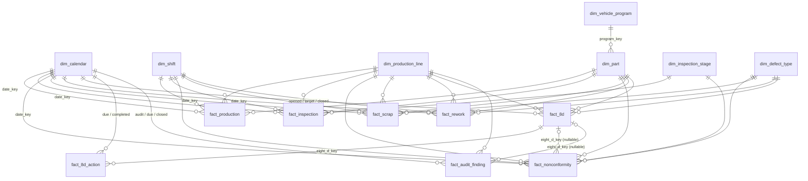

# Data Dictionary and Data Model — Phase 2

**Document status:** v0.1 for review. This is the contract that the SQL DDL (Phase 7), the Python ETL (Phase 6), the synthetic generator (Phase 5) and the Power BI model (Phase 9) must all follow.
**Related:** [01_project_blueprint.md](01_project_blueprint.md) (§5 design rationale, §14 decision log)
**Date:** 2026-11-11

---

## 1. Conventions (apply everywhere)

| Topic | Rule |
|---|---|
| Names | `snake_case`, lower case, English. Tables `dim_*`, `fact_*`; config tables have no prefix (`kpi_target`). The same column name is used in source files after standardisation, Python DataFrames, SQL and Power BI. |
| Schemas | `stg` (staging, truncated per load), `dw` (star schema), `audit` (lineage and DQ), `rpt` (views for Power BI) |
| Surrogate keys | `<entity>_key`, `INT IDENTITY` (`BIGINT` for high-volume facts). Never shown to report users. |
| Business keys | Natural names (`part_number`, `nc_id`), `UNIQUE` constraint, used by `MERGE` |
| Date keys | `INT` in `yyyymmdd` form, FK to `dim_calendar.date_key`. Mandatory event dates are `NOT NULL`; optional dates (closure, completion) are `NULL`. |
| Special members | Every dimension (except the calendar) has **−1 = "Unknown"** (code not found in master data) and **−2 = "Not applicable"** (e.g. a plant-wide audit finding with no line). Facts never hold `NULL` dimension keys, except nullable date keys and `eight_d_key`. |
| Quantities | `INT`, `CHECK (>= 0)`; event quantities `CHECK (> 0)` |
| Money | EUR (D2). Amounts `DECIMAL(18,2)`; unit costs and rates `DECIMAL(18,4)` (sub-cent precision before multiplying) |
| Text | `NVARCHAR` for free text (names, descriptions, possibly with non-ASCII owner names); `VARCHAR` for codes |
| Timestamps | `DATETIME2(0)`, UTC, suffix `_utc` |
| Booleans | `BIT`, prefix `is_` |
| Lineage columns (all `dw` tables) | `etl_run_id INT NOT NULL` (FK `audit.etl_run`), `source_file NVARCHAR(260) NOT NULL`, `loaded_at_utc DATETIME2(0) NOT NULL`, `updated_at_utc DATETIME2(0) NULL` (set by MERGE on update). They are listed once here and omitted from the tables below. |

---

## 2. Entity relationship diagram

---

## 3. Dimensions (schema `dw`)

### 3.1 `dim_calendar` — one row per day
Generated by SQL, not loaded from a file. Range: 2024-01-01 to 2027-12-31 (covers 24 months of history plus open 8D target dates).

| Column | Type | Null | Key | Description / rule |
|---|---|---|---|---|
| date_key | INT | N | PK | `yyyymmdd`, e.g. 20250314 |
| date | DATE | N | UQ | Calendar date |
| year | SMALLINT | N | | 2025 |
| quarter | TINYINT | N | | 1–4 |
| quarter_label | CHAR(7) | N | | `2025-Q1` |
| month | TINYINT | N | | 1–12 |
| month_name | VARCHAR(10) | N | | `March` |
| month_short | CHAR(3) | N | | `Mar` |
| year_month | CHAR(7) | N | | `2025-03` (sorts correctly as text) |
| month_start_date | DATE | N | | First day of the month, used for monthly KPI views |
| iso_year | SMALLINT | N | | ISO-8601 week-numbering year |
| iso_week | TINYINT | N | | 1–53 |
| day_of_week | TINYINT | N | | 1 = Monday … 7 = Sunday (independent of `DATEFIRST`) |
| day_name | VARCHAR(10) | N | | `Friday` |
| is_weekend | BIT | N | | Sat/Sun |
| is_plant_holiday | BIT | N | | Fictional plant holiday list (in `config/settings.toml`) |
| is_working_day | BIT | N | | NOT weekend AND NOT holiday |

**D8:** fiscal year = calendar year, so no fiscal columns are needed. If that changes, add `fiscal_year` / `fiscal_period`.

### 3.2 `dim_shift`
| Column | Type | Null | Key | Description |
|---|---|---|---|---|
| shift_key | INT | N | PK | |
| shift_code | VARCHAR(5) | N | UQ | `E`, `L`, `N` |
| shift_name | NVARCHAR(30) | N | | Early, Late, Night |
| start_time | TIME(0) | N | | 06:00 / 14:00 / 22:00 |
| end_time | TIME(0) | N | | 14:00 / 22:00 / 06:00 |
| crosses_midnight | BIT | N | | 1 for Night |
| sort_order | TINYINT | N | | 1, 2, 3 |

**Production-date rule:** a night shift that starts at 22:00 on day *D* is booked to production date *D*, even for events after midnight. Python enforces this when a timestamp is provided (test `UT-SHIFT-01`).

### 3.3 `dim_production_line`
| Column | Type | Null | Key | Description |
|---|---|---|---|---|
| line_key | INT | N | PK | |
| line_code | VARCHAR(5) | N | UQ | `L01` … `L06` |
| line_name | NVARCHAR(60) | N | | e.g. `Injection Moulding 1` |
| process_type | VARCHAR(30) | N | | `Injection Moulding`, `Painting`, `Assembly`, `Welding` |
| area | NVARCHAR(30) | N | | Plant hall, e.g. `Hall A` |
| is_active | BIT | N | | |

**Allowed source spellings** are mapped to `line_code` through `config/source_schemas.toml` (for example `Line 1`, `LINE-01`, `L1` → `L01`).

### 3.4 `dim_vehicle_program`
| Column | Type | Null | Key | Description |
|---|---|---|---|---|
| program_key | INT | N | PK | |
| program_code | VARCHAR(15) | N | UQ | `VP-SUV-C`, `VP-HATCH-B`, `VP-EV-D` |
| program_name | NVARCHAR(60) | N | | |
| oem_customer | NVARCHAR(60) | N | | **Fictional** OEM name (no real brands) |
| vehicle_segment | VARCHAR(20) | N | | `C-SUV`, `B-Hatch`, `D-EV` |
| sop_date | DATE | N | | Start of production |
| eop_date | DATE | Y | | End of production; NULL = still running |

`lifecycle_phase` (Launch = first 90 days after SOP / Serial / Run-out = last 180 days before EOP) is **derived in `rpt.v_dim_part`**, not stored, because it depends on the reference date.

### 3.5 `dim_part`
| Column | Type | Null | Key | Description |
|---|---|---|---|---|
| part_key | INT | N | PK | |
| part_number | VARCHAR(20) | N | UQ | Format `DAC-#####`, e.g. `DAC-10421` |
| part_name | NVARCHAR(100) | N | | |
| component_type | VARCHAR(30) | N | | `Door Panel`, `Dashboard`, `Bracket`, `Bumper`, `Trim` … |
| program_key | INT | N | FK → dim_vehicle_program | One program per part (simulation assumption, documented) |
| primary_line_key | INT | N | FK → dim_production_line | Line where the part is normally produced |
| standard_unit_cost_eur | DECIMAL(18,4) | N | | > 0; current standard cost |
| opportunities_per_unit | SMALLINT | N | | > 0; defect opportunities per unit (for DPMO) |
| is_active | BIT | N | | |

**D7:** a cost change overwrites `standard_unit_cost_eur` (Type 1), but the facts keep the cost that applied when they were loaded (`unit_cost_eur`), so historical scrap cost never changes.

### 3.6 `dim_defect_type`
| Column | Type | Null | Key | Description |
|---|---|---|---|---|
| defect_type_key | INT | N | PK | |
| defect_code | VARCHAR(10) | N | UQ | `<CAT>-<nn>`, e.g. `DIM-03`, `SUR-01` |
| defect_name | NVARCHAR(80) | N | | e.g. `Sink mark`, `Paint run`, `Missing clip` |
| defect_category | VARCHAR(20) | N | | `Dimensional`, `Surface`, `Assembly`, `Material`, `Functional` |
| severity | CHAR(1) | N | | `A` critical (safety/function), `B` major, `C` minor/cosmetic |

### 3.7 `dim_inspection_stage`
| Column | Type | Null | Key | Description |
|---|---|---|---|---|
| stage_key | INT | N | PK | |
| stage_code | VARCHAR(10) | N | UQ | `IPC` in-process check, `EOL` end-of-line test, `FA` final audit |
| stage_name | NVARCHAR(40) | N | | |
| stage_sequence | TINYINT | N | | 1, 2, 3; used to find the **final stage** of a line (highest sequence with data) |

Which stages a line uses is driven by the data: Moulding and Welding lines have `EOL` only, Painting has `IPC` + `EOL`, and Assembly has `IPC` + `EOL` + `FA`. FTY (D1) multiplies the FPY of the stages that have inspections for that line in the period.

### 3.8 `kpi_target` (configuration table)
| Column | Type | Null | Key | Description |
|---|---|---|---|---|
| kpi_target_key | INT | N | PK | |
| kpi_code | VARCHAR(30) | N | UQ (with valid_from) | e.g. `FPY_PCT`, matches the KPI dictionary and the DAX measure name |
| valid_from | DATE | N | | |
| valid_to | DATE | Y | | NULL = current |
| target_value | DECIMAL(18,6) | N | | Ratios stored as fractions (0.97) |
| amber_limit | DECIMAL(18,6) | N | | Edge of the amber band |
| direction | VARCHAR(16) | N | | `higher_better` / `lower_better` |
| unit | VARCHAR(10) | N | | `pct`, `eur`, `days`, `count` |
| target_type | VARCHAR(15) | N | | `Illustrative` for every row in this project (see blueprint §6) |

---

## 4. Facts (schema `dw`)

### 4.1 `fact_production` — grain: date × shift × line × part
Source: `production_daily_YYYY_MM.xlsx` (Production)

| Column | Type | Null | Key | Description / rule |
|---|---|---|---|---|
| production_key | BIGINT | N | PK | Identity |
| date_key | INT | N | FK, UQ part | |
| shift_key | INT | N | FK, UQ part | |
| line_key | INT | N | FK, UQ part | |
| part_key | INT | N | FK, UQ part | |
| qty_planned | INT | N | | ≥ 0 |
| qty_started | INT | N | | ≥ 0. Units that entered the line = **denominator for scrap and rework rate** |

Unique business key: (date_key, shift_key, line_key, part_key).

### 4.2 `fact_inspection` — grain: date × shift × line × part × stage
Source: `qa_inspections.csv` (QA)

| Column | Type | Null | Key | Description / rule |
|---|---|---|---|---|
| inspection_key | BIGINT | N | PK | |
| date_key, shift_key, line_key, part_key, stage_key | INT | N | FK, UQ | |
| qty_inspected | INT | N | | ≥ 0 |
| qty_passed_first_time | INT | N | | ≥ 0 |
| qty_failed | INT | N | | ≥ 0 |

`CHECK (qty_passed_first_time + qty_failed = qty_inspected)`. This hard constraint is acceptable because all three numbers come from the same department and file. Re-inspected units after rework are **not** counted again in `qty_inspected` (that is what makes the yield "first pass").

### 4.3 `fact_nonconformity` — grain: one NC record
Source: `qa_defects.csv` (QA)

| Column | Type | Null | Key | Description / rule |
|---|---|---|---|---|
| nc_key | BIGINT | N | PK | |
| nc_id | VARCHAR(20) | N | UQ | `NC-YYYY-######` |
| date_key, shift_key, line_key, part_key, stage_key, defect_type_key | INT | N | FK | |
| qty_affected | INT | N | | > 0. Number of **defects** (a unit with two defect types produces two NC rows) |
| disposition | VARCHAR(20) | N | | `Scrap`, `Rework`, `Use-as-is`, `Return-to-supplier` |
| eight_d_key | INT | Y | FK → fact_8d | Set when an 8D lists this NC (many NCs → one 8D) |

### 4.4 `fact_scrap` — grain: one scrap booking
Source: `scrap_log.csv` (Production / Finance)

| Column | Type | Null | Key | Description / rule |
|---|---|---|---|---|
| scrap_key | BIGINT | N | PK | |
| scrap_id | VARCHAR(20) | N | UQ | `SC-YYYY-######` |
| date_key, shift_key, line_key, part_key, defect_type_key | INT | N | FK | |
| qty_scrapped | INT | N | | > 0 |
| unit_cost_eur | DECIMAL(18,4) | N | | Snapshot of `dim_part.standard_unit_cost_eur` at load time (D7) |
| scrap_cost_eur | DECIMAL(18,2) | N | | Computed, persisted: `ROUND(qty_scrapped * unit_cost_eur, 2)` |

### 4.5 `fact_rework` — grain: one rework job
Source: `rework_log.xlsx` (Rework)

| Column | Type | Null | Key | Description / rule |
|---|---|---|---|---|
| rework_key | BIGINT | N | PK | |
| rework_id | VARCHAR(20) | N | UQ | `RW-YYYY-######` |
| date_key, shift_key, line_key, part_key, defect_type_key | INT | N | FK | |
| qty_reworked | INT | N | | > 0 |
| qty_rework_ok | INT | N | | 0 ≤ qty_rework_ok ≤ qty_reworked |
| labour_hours | DECIMAL(9,2) | N | | > 0 |
| labour_rate_eur | DECIMAL(18,4) | N | | From `config/settings.toml` (one plant rate, illustrative) |
| rework_cost_eur | DECIMAL(18,2) | N | | Reported value, or `labour_hours × labour_rate_eur` if missing |
| cost_source | VARCHAR(10) | N | | `Reported` / `Imputed` (**D12**: imputations are visible, not hidden) |

### 4.6 `fact_8d` — grain: one 8D report (accumulating snapshot)
Source: `8d_tracker.xlsx` (Quality engineering)

| Column | Type | Null | Key | Description / rule |
|---|---|---|---|---|
| eight_d_key | INT | N | PK | |
| eight_d_id | VARCHAR(15) | N | UQ | `8D-YYYY-###`. Display name "8D ID". |
| opened_date_key | INT | N | FK → calendar | = D1 date |
| part_key, line_key, defect_type_key | INT | N | FK | |
| problem_source | VARCHAR(20) | N | | `Internal`, `Customer complaint`, `Audit` |
| owner_name | NVARCHAR(80) | N | | Fictional names only |
| owner_department | NVARCHAR(40) | N | | |
| d1_date … d8_date | DATE | Y | | Milestone dates. A DQ rule checks d(n) ≥ d(n−1); a violation is flagged, **not** rejected. |
| target_closure_date_key | INT | N | FK → calendar | |
| closed_date_key | INT | Y | FK → calendar | = d8_date. **Closed is derived from this, not from the text status.** |
| status_reported | NVARCHAR(30) | Y | | Free-text status from Excel, kept for DQ comparison only |

Linked NC IDs in the tracker (comma-separated) are split by Python and written to `fact_nonconformity.eight_d_key`.

### 4.7 `fact_8d_action` — grain: one action item
Source: `8d_actions.xlsx`

| Column | Type | Null | Key | Description / rule |
|---|---|---|---|---|
| action_key | INT | N | PK | |
| action_id | VARCHAR(20) | N | UQ | `8D-YYYY-###-A##` |
| eight_d_key | INT | N | FK → fact_8d | Unknown 8D → row rejected (an action without its 8D is meaningless) |
| action_type | VARCHAR(12) | N | | `Containment`, `Corrective`, `Preventive` |
| action_description | NVARCHAR(500) | N | | |
| owner_name | NVARCHAR(80) | N | | |
| due_date_key | INT | N | FK → calendar | |
| completed_date_key | INT | Y | FK → calendar | NULL = not completed |
| status_reported | NVARCHAR(30) | Y | | DQ comparison only |

### 4.8 `fact_audit_finding` — grain: one audit finding
Source: `audit_findings.xlsx` (Quality management)

| Column | Type | Null | Key | Description / rule |
|---|---|---|---|---|
| finding_key | INT | N | PK | |
| finding_id | VARCHAR(20) | N | UQ | `AF-YYYY-####` |
| audit_id | VARCHAR(20) | N | | Degenerate dimension, `AU-YYYY-###` |
| audit_date_key | INT | N | FK → calendar | |
| audit_type | VARCHAR(20) | N | | `System`, `Process`, `Product`, `Layered Process`, `Customer` |
| standard_reference | VARCHAR(30) | Y | | Clause-style reference (e.g. `IATF 16949 8.5.1`, `VDA 6.3 P6.4`). Reference only, no standard text |
| line_key | INT | N | FK | −2 "Not applicable" for plant-wide findings |
| classification | VARCHAR(15) | N | | `Major NC`, `Minor NC`, `Observation`, `OFI` (standardised from source variants) |
| finding_description | NVARCHAR(500) | N | | |
| owner_name | NVARCHAR(80) | N | | |
| due_date_key | INT | N | FK → calendar | |
| closed_date_key | INT | Y | FK → calendar | |
| eight_d_key | INT | Y | FK → fact_8d | Major NCs usually link to an 8D |
| status_reported | NVARCHAR(30) | Y | | DQ comparison only |

---

## 5. Audit schema (`audit`)

| Table | Grain | Key columns |
|---|---|---|
| `etl_run` | One pipeline run | etl_run_id (PK, identity), started_at_utc, ended_at_utc, environment (`dev`/`prod`), status (`Running`/`Succeeded`/`Failed`/`Partial`), files_processed, rows_read, rows_loaded, rows_rejected, git_commit, triggered_by (`manual`/`scheduler`), error_message |
| `file_manifest` | One source file per run | file_id (PK), etl_run_id (FK), source_name (e.g. `scrap_log`), file_name, blob_path, file_sha256 (**UQ per source_name** → incremental skip), file_size_bytes, row_count, status (`Loaded`/`Skipped-duplicate`/`Failed`), processed_at_utc |
| `rejected_row` | One rejected source row | rejected_row_id (PK), etl_run_id, file_id, source_row_number, rule_id (FK → `validation_rule`), reason, raw_record (NVARCHAR(MAX) JSON) |
| `validation_rule` | One rule | rule_id (PK, e.g. `VR-SCR-03`), source_name, severity (`Reject` / `Warn`), description |
| `dq_result` | One check per run | dq_result_id, etl_run_id, check_id (e.g. `DQ-07`), passed (BIT), measured_value, threshold, details |
| `schema_version` | One applied DDL script | script_name (PK), applied_at_utc, checksum |

**Staging (`stg`):** one table per source (`stg.production`, `stg.inspection`, …). Columns are the **standardised source columns** (already typed by Python), plus `source_file` and `source_row_number`. Staging is truncated at the start of each load, and `MERGE` procedures move rows from `stg` into `dw`.

---

## 6. Source-to-target mapping (summary)

| Source file | Staging | Target | Business key | Dimension lookups |
|---|---|---|---|---|
| master_parts.xlsx | stg.part | dim_part | part_number | program_code → program_key, line_code → primary_line_key |
| master_lines.xlsx | stg.line | dim_production_line | line_code | — |
| master_programs.xlsx | stg.program | dim_vehicle_program | program_code | — |
| master_defects.xlsx | stg.defect_type | dim_defect_type | defect_code | — |
| production_daily_*.xlsx | stg.production | fact_production | date+shift+line+part | all, by code |
| qa_inspections.csv | stg.inspection | fact_inspection | date+shift+line+part+stage | all, by code |
| qa_defects.csv | stg.nonconformity | fact_nonconformity | nc_id | all, by code |
| scrap_log.csv | stg.scrap | fact_scrap | scrap_id | all, by code; unit cost from dim_part |
| rework_log.xlsx | stg.rework | fact_rework | rework_id | all, by code |
| 8d_tracker.xlsx | stg.eight_d (+ stg.eight_d_nc_link) | fact_8d (+ update fact_nonconformity.eight_d_key) | eight_d_id | part, line, defect |
| 8d_actions.xlsx | stg.eight_d_action | fact_8d_action | action_id | eight_d_id → eight_d_key |
| audit_findings.xlsx | stg.audit_finding | fact_audit_finding | finding_id | line (−2 if blank), eight_d_id |

**Load order:** master data → calendar check → production → inspection → 8D → nonconformity (needs `eight_d_key`) → scrap → rework → 8D actions → audit findings.

---

## 7. Validation rule catalogue (initial)

These rules drive both the synthetic generator (which injects violations) and the ETL validator. *Reject* = the row goes to `audit.rejected_row`; *Warn* = the row is loaded and flagged in `audit.dq_result`.

| Rule | Applies to | Check | Action |
|---|---|---|---|
| VR-GEN-01 | all | Required columns present (header check) | Reject **file** |
| VR-GEN-02 | all | Mandatory fields not empty | Reject |
| VR-GEN-03 | all | Date parseable (accepted formats: `YYYY-MM-DD`, `DD.MM.YYYY`, `DD/MM/YYYY`, Excel serial) | Reject |
| VR-GEN-04 | all | Exact duplicate row within the file | Drop duplicate, Warn |
| VR-GEN-05 | all | Business key duplicated with different values | Reject both, Warn |
| VR-GEN-06 | all | Code not found in master data (after the spelling map) | Load with key −1, Warn |
| VR-GEN-07 | all | Event date in the future or before 2024-01-01 | Reject |
| VR-QTY-01 | quantities | Negative quantity | Reject |
| VR-INS-01 | inspection | passed + failed ≠ inspected | Reject |
| VR-RWK-01 | rework | qty_rework_ok > qty_reworked | Reject |
| VR-RWK-02 | rework | Missing cost → impute from hours × rate | Load, `cost_source = Imputed`, Warn |
| VR-8D-01 | 8D | d(n) < d(n−1) (milestones out of order) | Load, Warn |
| VR-8D-02 | 8D | Status text says "Closed" but D8 is empty (or the reverse) | Load, Warn; D8 is the truth |
| VR-8D-03 | 8D actions | 8D ID unknown | Reject |
| VR-AF-01 | audit findings | Classification variant not mappable | Reject |

**Cross-source data-quality checks (`audit.dq_result`):**
| Check | Rule | Threshold (illustrative) |
|---|---|---|
| DQ-01 | Every (date, shift, line, part) in inspection exists in production | 100 % |
| DQ-02 | Σ qty_inspected at the final stage ≤ Σ qty_started per line and month | 100 % |
| DQ-07 | Σ NC qty with disposition Scrap vs Σ fact_scrap qty per line and month | within ±2 % |
| DQ-08 | Σ NC qty with disposition Rework vs Σ fact_rework qty per line and month | within ±2 % |
| DQ-10 | Rejected rows / rows read per run | ≤ 5 % |

---

## 8. Power BI model rules (derived from this design)

| Rule | Reason |
|---|---|
| Load `rpt.v_*` views only, never `dw` tables directly | The reporting contract stays stable if `dw` changes |
| **D10:** `rpt.v_dim_part` is flattened with program columns; `dim_vehicle_program` is not loaded separately | Avoids a snowflake in Power BI; slicing by program works on every fact through the part |
| Calendar relationships: **active** on the main event date of each fact (`date_key`, `opened_date_key`, `audit_date_key`); **inactive** on due, target, completed and closed dates, activated in measures with `USERELATIONSHIP` | Only one active path between two tables |
| **D9:** `fact_8d → fact_8d_action` active (1:*); `fact_8d → fact_nonconformity` and `fact_8d → fact_audit_finding` **inactive** | Otherwise `dim_part` would reach `fact_nonconformity` both directly and via `fact_8d`, which is an ambiguous path that Power BI refuses. Measures such as "NCs linked to open 8Ds" use `USERELATIONSHIP` / `TREATAS`. |
| `fact_8d_action` calendar relationships all inactive | Its only active filter path is through `fact_8d` |
| All relationships single-direction, dimension → fact | Predictable filtering, no ambiguity |
| Surrogate and lineage columns hidden; measures in a `_Measures` table with display folders per KPI category | Clean field list for users |
| Auto date/time **off** | `dim_calendar` is the only date table |

---

## 9. Decisions added in Phase 2 (append to the blueprint §14 log)

| ID | Decision | Reason |
|---|---|---|
| D8 | Fiscal year = calendar year | No fiscal data in the scenario; easy to extend |
| D9 | 8D-to-NC and 8D-to-audit-finding relationships are inactive in Power BI | Avoids ambiguous filter paths |
| D10 | Vehicle program flattened into the part view for Power BI | Star, not snowflake, in the BI layer; the normalised form stays in SQL |
| D11 | Two special members: −1 Unknown, −2 Not applicable | Distinguishes bad data from a legitimately missing dimension |
| D12 | Imputed costs are flagged with `cost_source` | Transparency: management can see how much cost is estimated |

---

## 10. Review outcome (2026-11-11)

1. **Line → inspection stages** (§3.7): ✅ approved. Moulding/Welding = EOL; Painting = IPC + EOL; Assembly = IPC + EOL + FA.
2. **Rework labour rate:** ✅ one plant-wide illustrative rate of €38.00/h, stored in `config/settings.toml`.
3. **Calendar range:** ✅ `dim_calendar` covers 2024-01-01 to 2027-12-31; synthetic history covers 2024-11-01 to 2026-10-31 (24 months).

Decisions D8–D12 were accepted with this review.

---

## 11. Phase 7 implementation notes (2026-11-11)

The DDL in `sql/ddl/` implements this dictionary. Where the implementation had to add detail, this is it:

| Topic | Implementation |
|---|---|
| Deployment | `python -m etl.deploy --env dev\|prod`. Versioned scripts `sql/ddl/NNN_*.sql` are applied once each; repeatable scripts in `sql/etl/` and `sql/rpt/` (`CREATE OR ALTER`) are re-applied when their checksum changes (**D18**). |
| `audit.schema_version` | Columns as in §5, plus `script_kind` (`versioned` / `repeatable`), `applied_by` and `git_commit`. Created by `000_schema_version.sql` (deploy bootstrap). The checksum is SHA-256 with line endings normalised to LF. |
| `audit.etl_run` run 0 | `etl_run_id = 0`, `triggered_by = 'deploy'`. It owns every row seeded by DDL scripts (special members, shifts, stages, holidays, calendar), so lineage columns stay `NOT NULL` (**D19**). |
| `audit.file_manifest` | "Hash unique per source" is a **filtered** unique index `(source_name, file_sha256) WHERE status = 'Loaded'`, so skipped or failed attempts with the same hash can still be logged (**D20**). |
| `audit.validation_rule` | Extra column `action` (what the pipeline does). Seeded from §7 by `050_seed_validation_rules.sql`. |
| `dw.plant_holiday` *(new)* | `holiday_date` (PK), `holiday_type` (`Annual` / `Shutdown`), plus lineage. Synchronised from `config/settings.toml` on every deploy; `etl.usp_build_calendar` reads it (**D17**). |
| `dim_calendar` | Built by `etl.usp_build_calendar`, independent of `SET DATEFIRST` and `SET LANGUAGE`. `iso_year` = year of the ISO week's Thursday. |
| Special members | Codes `UNK`/`N/A` (shift, line; `VARCHAR(5)`) or `UNKNOWN`/`N/A` (others). Unknown part: cost 0, 1 opportunity. Unknown program: `sop_date = 1900-01-01` (sentinel; views treat keys < 0 separately). Defect severity `-`. Stage sequence 0, so it is never a "final stage". |
| Staging column names | Event dates are `event_date` in `stg.production`, `stg.inspection`, `stg.nonconformity`, `stg.scrap` and `stg.rework`; other dates keep their dictionary names (`opened_date`, `due_date`, …). The part's line is `stg.part.primary_line_code`. |
| Roles | `etl_writer` (stg read/write/truncate, audit read/write, dw read, EXECUTE on `etl`) and `rpt_reader` (SELECT on `rpt`). Users are created outside Git because SQL users need passwords (`040_security.sql` header). |
| CHECK constraints and NULL | A CHECK only rejects FALSE; UNKNOWN passes. Constraints over nullable columns spell out every branch (`021_fix_8d_closed_check.sql`). |

### 11.1 Load procedures (`sql/etl/`, schema `etl`)

Called by the Python pipeline in the load order of §6, inside the pipeline's transaction. Each one returns counts through OUTPUT parameters for `audit.etl_run`.

| Procedure | Target | Notes |
|---|---|---|
| `usp_merge_line`, `_program`, `_part`, `_defect_type` | dimensions | Type 1 overwrite; never deletes; special members never touched |
| `usp_merge_production`, `_inspection` | periodic facts | Duplicate check on the **resolved** grain |
| `usp_merge_8d` | `fact_8d` | `opened_date_key` = D1 (else tracker opened date); `closed_date_key` = D8 |
| `usp_merge_nonconformity` | `fact_nonconformity` | Never writes `eight_d_key` |
| `usp_apply_8d_nc_links` | `fact_nonconformity.eight_d_key` | Snapshot per staged 8D: NCs no longer listed are unlinked. NCs not yet loaded are counted (`@links_unresolved`) and linked by the next tracker load. One NC listed under two 8Ds → error |
| `usp_merge_scrap` | `fact_scrap` | `unit_cost_eur` snapshot taken on insert and kept on correction unless the part changes (D7) |
| `usp_merge_rework` | `fact_rework` | Costs arrive complete (imputed by Python, VR-RWK-02) |
| `usp_merge_8d_action` | `fact_8d_action` | Unknown 8D → error (the validator should have rejected it, VR-8D-03) |
| `usp_merge_audit_finding` | `fact_audit_finding` | Blank line → −2, unknown line → −1; unknown 8D ID → NULL and counted |

**Shared contract:** the run must exist with status `Running` (`usp_assert_run`). Duplicate business keys in staging raise an error instead of being merged unpredictably. Only rows whose values changed are updated (null-safe `EXCEPT` comparison), so a reload of the same file reports 0 inserted and 0 updated. Facts are never deleted.

**Resolved open point:** two *different* unknown codes on the same date, shift and line both map to `part_key = -1`. The periodic-fact procedures detect this on the resolved grain and raise an error. The validator must therefore reject such rows with VR-GEN-05 (Phase 6).
